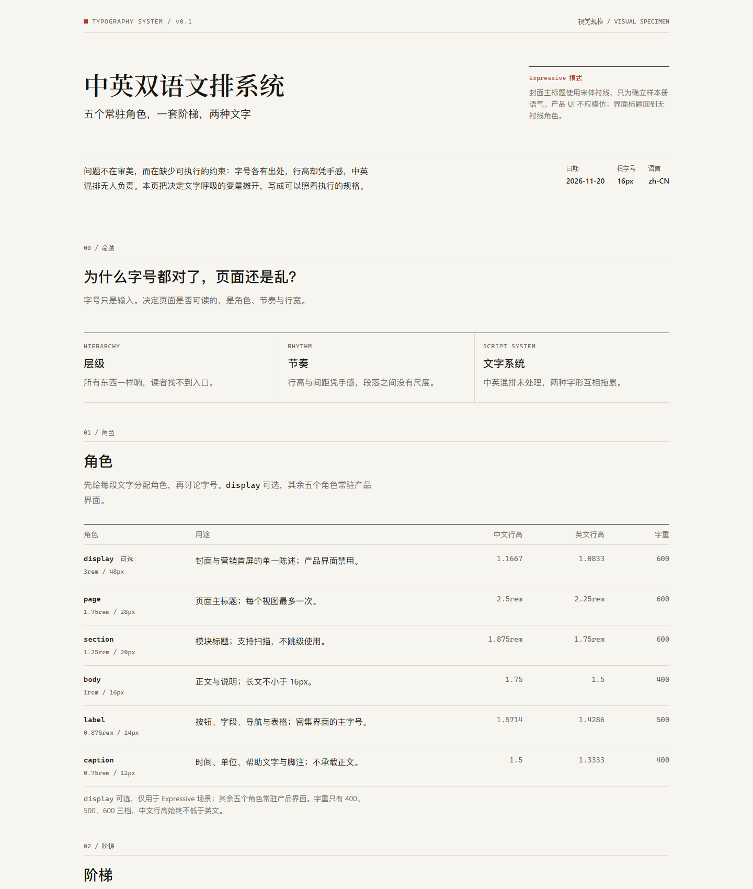

# typography-system

A bilingual (Chinese / English) typography skill for coding agents.

[中文说明](README.zh-CN.md) · [Visual specimen](skills/typography-system/examples/spec.html) · [MIT License](LICENSE)



Most agent-generated UI fails typography in the same way: every component decides its own font size, weight, and line height, so every page looks like a different product. The fix is not a prettier style guide — it is a **small, enforceable system** the agent cannot route around.

This skill gives an agent:

- **6 semantic roles** (page, section, body, label, caption, optional display) and a fixed ramp.
- **Separate CJK and Latin metrics** — line height, tracking, punctuation, line breaking, font stacks, and weight availability.
- **Five context modes** — productive, reading, expressive, reference, presentation — plus native platform ramps.
- **Token architecture** — CSS, DTCG, Tailwind v4, and Figma naming that match.
- **Enforcement** — AGENTS.md rules, Stylelint/ESLint config, a zero-dependency audit script, and a visual QA protocol.

English is the default: `SKILL.md` and `references/en/`. A complete Chinese version is included as `SKILL.zh-CN.md` and `references/`.

## Install

Requires Node.js 22.20+.

```bash
# install into the current project, pick the agent(s) interactively
npx skills add modenicheng/typography-skill --skill typography-system

# or install for Claude Code only
npx skills add modenicheng/typography-skill --skill typography-system -a claude-code

# global install
npx skills add modenicheng/typography-skill --skill typography-system -g
```

The CLI copies the skill to `.agents/skills/typography-system` and links it into the agent's skill directory. `npx skills check` / `npx skills update` keep it current.

You can also clone the repo and copy `skills/typography-system/` into `~/.claude/skills/` or `~/.agents/skills/` manually.

## See it

Open `skills/typography-system/examples/spec.html` in a browser. It is a self-contained spec sheet: the ramp rendered at real size in Chinese and English, density toggles, line-height and measure comparisons, mixed-script spacing and punctuation-trim demos, component samples, and before/after anti-patterns.

## The default ramp

Product / standard density. Chinese is the default; English leading is applied on `:root:lang(en)`.

| Role | Size | CJK leading | Latin leading | Weight | Use |
|---|---|---|---|---|---|
| display | 48px | 1.1667 (56px) | 1.0833 (52px) | 600 | marketing/cover only |
| page | 28px | 1.4286 (40px) | 1.2857 (36px) | 600 | one per page |
| section | 20px | 1.5 (30px) | 1.4 (28px) | 600 | module heading |
| body | 16px | 1.75 (28px) | 1.5 (24px) | 400 | prose, descriptions |
| label | 14px | 1.5714 (22px) | 1.4286 (20px) | 500 | buttons, forms, tables |
| caption | 12px | 1.5 (18px) | 1.3333 (16px) | 400 | helper, meta |

Rules that matter more than the numbers:

- One screen: ≤5 sizes, ≤3 weights, ≤2 families.
- Measure = `34em` ≈ 34 Chinese characters ≈ 68 Latin characters.
- Chinese body line height ≥ 1.6; never add letter-spacing to Chinese.
- Chinese emphasis uses 500, not 600 — Microsoft YaHei has only 300/400/700.
- Never italicize Chinese; never `word-break: break-all`.
- Mixed-script spacing comes from `text-autospace`, not hand-typed spaces.

## Structure

```
skills/typography-system/
├── SKILL.md                  # English contract + router (always loaded)
├── SKILL.zh-CN.md            # Chinese contract + router
├── references/
│   ├── 01-principles.md      # Chinese: hierarchy, rhythm, typographic color
│   ├── 02-scale.md
│   ├── 03-bilingual.md
│   ├── 04-scenarios.md
│   ├── 05-components.md
│   ├── 06-tokens.md
│   ├── 07-enforcement.md
│   ├── 08-sources.md
│   └── en/                   # English translations, one per layer
│       ├── 01-principles.md
│       ├── 02-scale.md
│       ├── 03-bilingual.md
│       ├── 04-scenarios.md
│       ├── 05-components.md
│       ├── 06-tokens.md
│       ├── 07-enforcement.md
│       └── 08-sources.md
├── templates/
│   ├── tokens.css
│   ├── tokens.tokens.json
│   ├── AGENTS.typography.md
│   └── audit.mjs
└── examples/
    └── spec.html
```

Progressive disclosure: `SKILL.md` stays small and routes to one reference file per task. The agent reads only what it needs.

## Design decisions

**Why six roles, not a full type scale.** Carbon and Ant both ship dozens of tokens. That is right for a design-system team and wrong for an agent: the more tokens exist, the more likely the agent picks the wrong one. Six roles cover product UI; optional `display` is explicitly fenced off from product surfaces.

**Why the CJK/Latin split.** At the same pixel size, Han characters fill the em box while Latin letters live around the x-height. Chinese therefore looks larger and denser, needs roughly 0.15–0.25 more line height, and must not receive tracking. These are not stylistic preferences; they come from the square character frame (W3C clreq) and font metrics.

**Why `34em`.** One Han character is about 1em; an average Latin character is about 0.5em. A single measure rule works for both scripts: `max-inline-size: 34em` gives ~34 Chinese characters or ~68 Latin characters per line, inside the 45–90 character range USWDS and Practical Typography recommend.

**Why 500 for Chinese emphasis.** PingFang has six weights, Microsoft YaHei has three (300/400/700), and Noto Sans SC is variable. Requesting 600 on YaHei silently snaps to 700, which looks broken. 500 is the safest emphasis step across platforms.

**Why lint + audit script.** A style guide an agent can ignore is a suggestion. Stylelint blocks raw values at build time; `audit.mjs` covers files that lint does not reach (Vue/Svelte templates, inline styles, Tailwind arbitrary values); the AGENTS.md block makes the rule visible in the prompt.

## What this is not

- Not a font-pairing catalog. It recommends stacks and criteria, not specific commercial fonts.
- Not a layout or color system. It only covers type and the spacing that type depends on.
- Not a print typesetting engine. It borrows principles from print but targets screens.
- Not a replacement for looking at the page. Every reference ends with a verification checklist.

## Sources

W3C clreq, GB/T 15834—2011, WCAG 2.2 (1.4.4 / 1.4.12 / 1.4.3), Ant Design Font, IBM Carbon Typography, Microsoft Fluent 2, Apple HIG, USWDS Typography, Butterick's Practical Typography, Refactoring UI, W3C DTCG, Tailwind CSS, CSS Text Level 4. Annotations and caveats in `references/08-sources.md`.

## License

MIT. See [LICENSE](LICENSE).
