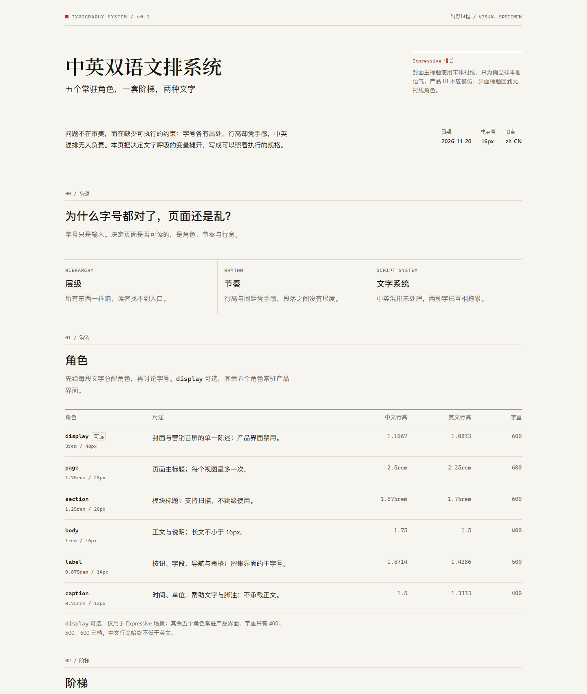

# typography-system

面向编码 Agent 的中英双语文排系统。

[English](README.md) · [视觉标本](skills/typography-system/examples/spec.html) · [MIT 许可](LICENSE)



Agent 生成的界面，排版问题几乎都长一个样：每个组件各自决定字号、字重、行高，于是每个页面都像另一个产品。解法不是写一份更漂亮的设计指南，而是给出一套**小、可执行、Agent 绕不过去**的约束。

这套 skill 提供：

- **6 个语义角色**（page、section、body、label、caption，外加可选 display）与固定阶梯。
- **中英两套度量**：行高、字距、标点、断行、字体栈、字重可用性分别处理。
- **5 种场景模式**：工作型、阅读型、表达型、参考型、演示型，另附原生平台字阶。
- **Token 架构**：CSS、DTCG、Tailwind v4、Figma 命名一一对应。
- **约束手段**：AGENTS.md 规则、Stylelint/ESLint、零依赖审计脚本、视觉验收协议。

技能正文用中文写，因为领域本身是中文排版；代码、token、命令和参考表是语言中立的。

## 安装

需要 Node.js 22.20+。

```bash
# 安装到当前项目，交互选择要写入的 Agent
npx skills add modenicheng/typography-skill --skill typography-system

# 只装给 Claude Code
npx skills add modenicheng/typography-skill --skill typography-system -a claude-code

# 全局安装
npx skills add modenicheng/typography-skill --skill typography-system -g
```

CLI 会把 skill 复制到 `.agents/skills/typography-system`，再链接进对应 Agent 的 skill 目录。`npx skills check` / `npx skills update` 用于检查与更新。

也可以直接克隆仓库，把 `skills/typography-system/` 手动放进 `~/.claude/skills/` 或 `~/.agents/skills/`。

## 看一眼

用浏览器打开 `skills/typography-system/examples/spec.html`。这是一个自包含的规格样本页：按真实字号排列的中英阶梯、密度切换、行高与行宽对照、混排间距与标点挤压开关、组件切片，以及反模式的前后对照。

## 默认阶梯

产品界面 / 标准密度。默认取中文行高，英文主语言页面在 `:root:lang(en)` 上收紧。

| 角色 | 字号 | 中文行高 | 英文行高 | 字重 | 用途 |
|---|---|---|---|---|---|
| display | 48px | 1.1667（56px） | 1.0833（52px） | 600 | 仅营销/封面 |
| page | 28px | 1.4286（40px） | 1.2857（36px） | 600 | 每页一个 |
| section | 20px | 1.5（30px） | 1.4（28px） | 600 | 模块标题 |
| body | 16px | 1.75（28px） | 1.5（24px） | 400 | 正文、说明 |
| label | 14px | 1.5714（22px） | 1.4286（20px） | 500 | 按钮、表单、表格 |
| caption | 12px | 1.5（18px） | 1.3333（16px） | 400 | 辅助信息、元数据 |

比数字更重要的规则：

- 一屏最多 5 个字号、3 个字重、2 个字体族。
- 行宽 `34em`：约 34 个汉字，或 68 个拉丁字符。
- 中文正文行高 ≥1.6；中文永远不加字距。
- 中文强调用 500，不用 600——微软雅黑只有 300/400/700。
- 中文不用斜体；不用 `word-break: break-all`。
- 中西文间距交给 `text-autospace`，不要手打空格。

## 结构

```
skills/typography-system/
├── SKILL.md                  # 契约 + 路由（唯一常驻上下文）
├── references/
│   ├── 01-principles.md      # 层级、克制、节奏、排版颜色
│   ├── 02-scale.md           # 阶梯构造、行高、字重、字距
│   ├── 03-bilingual.md       # 字体栈、标点、断行、数字
│   ├── 04-scenarios.md       # 工作 / 阅读 / 表达 / 参考 / 演示
│   ├── 05-components.md      # 标题、按钮、表格、表单、导航、图表
│   ├── 06-tokens.md          # CSS、DTCG、Tailwind、Figma、原生映射
│   ├── 07-enforcement.md     # AGENTS.md、lint、CI、视觉验收
│   └── 08-sources.md         # 逐条标注的来源与折扣
├── templates/
│   ├── tokens.css
│   ├── tokens.tokens.json
│   ├── AGENTS.typography.md
│   └── audit.mjs
└── examples/
    └── spec.html
```

渐进披露：`SKILL.md` 保持很小，按任务路由到一个参考文件。Agent 只读它需要的那一层。

## 设计取舍

**为什么是 6 个角色，而不是一整套字阶。** Carbon 和 Ant 都有几十个 token。那适合设计系统团队，不适合 Agent：token 越多，选错的概率越高。6 个角色足够覆盖产品界面；可选的 `display` 被明确挡在产品界面之外。

**为什么中英分开。** 同一像素值下，汉字撑满字身，拉丁字母只占 x-height 附近。所以中文看起来更大更密，需要多 0.15–0.25 的行高，而且不能加字距。这不是审美偏好，是方块字（W3C clreq）与字体度量的结果。

**为什么是 `34em`。** 一个汉字约 1em，一个拉丁字符平均约 0.5em。同一条行宽规则对两种文字都成立：`max-inline-size: 34em` 约等于每行 34 个汉字或 68 个拉丁字符，落在 USWDS 与 Practical Typography 建议的 45–90 字符区间内。

**为什么中文强调用 500。** 苹方有 6 档，微软雅黑只有 3 档（300/400/700），Noto Sans SC 是可变字重。在雅黑上请求 600 会静默跳到 700，看起来像坏了。500 是跨平台最安全的强调档。

**为什么要 lint + 审计脚本。** Agent 可以忽略的规范只是建议。Stylelint 在构建时拦住裸值；`audit.mjs` 覆盖 lint 到不了的文件（Vue/Svelte 模板、行内样式、Tailwind 任意值）；AGENTS.md 让规则出现在 prompt 里。

## 不适用

- 不是字体搭配目录：给的是字体栈与选择标准，不是某款商业字体。
- 不是布局或配色系统：只管文字，以及与文字相关的间距。
- 不是印刷排版引擎：借印刷原则，但面向屏幕。
- 不能替代看真实页面：每个参考文件都以验收清单结尾。

## 来源

W3C clreq、GB/T 15834—2011、WCAG 2.2（1.4.4 / 1.4.12 / 1.4.3）、Ant Design Font、IBM Carbon Typography、Microsoft Fluent 2、Apple HIG、USWDS Typography、Butterick's Practical Typography、Refactoring UI、W3C DTCG、Tailwind CSS、CSS Text Level 4。逐条标注与折扣见 `references/08-sources.md`。

## 许可

MIT。见 [LICENSE](LICENSE)。
